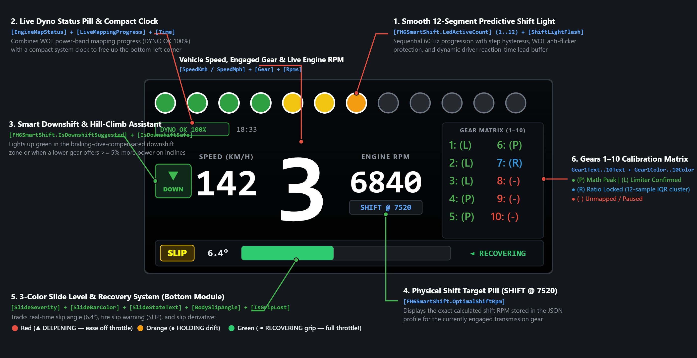

# 🏎️ FH6SmartShift (v1.0.1) — Virtual Dyno & Shift Telemetry System for Forza Horizon 6

[](https://www.simhubdash.com/)
[](https://dotnet.microsoft.com/)
[](https://docs.microsoft.com/en-us/dotnet/csharp/)
[](https://www.gnu.org/licenses/gpl-3.0)
[](https://buymeacoffee.com/mtowarek01d)

**Author:** mtowarek01  
**Version:** v1.0.1 (Pure Math & Telemetry Monolith, Smooth 12-LED, Slide Recovery & Virtual Dyno Inspector)

---

## 📖 About the Project

**FH6SmartShift** is an advanced C# telemetry plugin for **SimHub** and a dedicated racing dashboard suite designed specifically for the **Forza Horizon 6** physics engine.

Unlike simple scripts that only average rev-limiter bounce RPM, **FH6SmartShift** builds a real-time (60 Hz) engine profile based on a **401-band Virtual Dyno**. By capturing raw UDP data from the game — including engine power (`Power`), torque (`Torque`), boost pressure (`Boost`), wheel rotation speeds (`WheelRotationSpeed`), longitudinal and lateral tire slip (`TireSlipRatio`, `TireSlipAngle`), and suspension travel — the plugin calculates transmission gear ratios and finds the exact mathematical power curve intersection point between consecutive gears (Gears 1–10).

In **v1.0.1**, the system introduces an **Interactive HTML Virtual Dyno & Gearbox Inspector** (`FH6SmartShift_GarageReport.html`), a **60 Hz Smooth 12-LED Shift Light Engine** with step hysteresis, a **3-Color Slide Level & Recovery System** (`DEEPENING` vs. `HOLDING` vs. `RECOVERING`), and a bulletproof 12-sample IQR gear ratio learning algorithm.

---

## 🆕 What's New in v1.0.1

* **Interactive Virtual Dyno & Gearbox Inspector (`FH6SmartShift_GarageReport.html`):** Automatically generates a standalone, interactive HTML garage report in `PluginsData\Common\` (and opens it on demand via the `FH6SmartShift.OpenDynoReport` action in SimHub). Inspect saved cars, copy one-click engine summaries (HP, kW, Nm, Boost psi/bar, Ghost Limiter RPM), review full Gear 1–10 shift tables, and view 401-band Power & Torque curves.
* **Smooth 12-LED Shift Engine (`LedActiveCount` & `ShiftLightFlash`):** Eliminates LED skipping by scaling progression (`0.0–1.0`) directly to the buffered shift trigger with asymmetric EMA smoothing (`tau = 0.015 s` attack / `0.080 s` decay), WOT anti-flicker hold, and 12-stage hysteresis.
* **Slide Level & Recovery Telemetry (`SlideSeverity`, `SlideTrend`, `SlideBarColor`, `SlideStateText`):** Tracks real-time traction loss and calculates the time derivative of your slide to tell you whether a slide is **deepening** (Red `▲ DEEPENING`), **holding steady** (Orange `● HOLDING`), or **recovering** back to grip (Green `◄ RECOVERING`).
* **Bulletproof & Faster Dyno/Gear Learning:**
  * **Fast Ratio Lock (12 Samples + IQR Spread Filter):** Transmission ratios now learn from moderate throttle (`Accel >= 75`) in ~0.18 seconds once 12 samples form a tight cluster (`IQR spread < 1.2%`) and pass a global monotonicity check across all gears (`1..10`).
  * **Self-Healing Engine Map (`HealEngineMapPockets`):** Requires at least 2 consecutive clean WOT frames before writing, uses fast upward convergence (`alpha = 0.35`), rejects transient power dips (`< 88%` of local map), and automatically heals 1–2 band telemetry pockets.

---

## ⚙️ Architecture & Actual Operating Logic

* **401-Band Virtual Dyno (`PowerMap`, `TorqueMap`, `BoostMap`):** Sampling takes place near wide-open throttle (`Accel >= 240` on a `0–255` scale, i.e., **~94% throttle**), at power levels above `5000 W`, after at least 2 consecutive clean WOT frames (`_cleanWotFrames >= 2`). The range up to `20,000 RPM` is divided into 401 bands in `50 RPM` increments, updated with an asymmetric filter (`alpha = 0.35` for higher power readings, `0.08` for lower readings) and protected by automatic pocket healing (`HealEngineMapPockets`).
* **Power Curve Intersection Algorithm (`EvaluateAllMathIntersections`):** Every `0.15 s` (when data has changed), the algorithm compares smoothed engine power in the current gear (`pNow` at `r` RPM) against power after upshifting to the next gear (`pNext` at landing RPM `r * dropRatio`). If the engine is turbocharged (`Boost > 0.1`) and expected boost at landing RPM drops below `70%` of current boost, `pNext` is adjusted by a `0.85` multiplier. A shift point is confirmed as mathematically optimal `(P)` when, for `r >= RpmAtMaxPower`, the condition **`pNext >= pNow * 1.015`** (1.5% power advantage) is met across **5 consecutive 25 RPM steps** (or 2 steps near the mapped ceiling), and sample density in the active gear landing zone is at least **78%**.
* **Autonomous Gear Ratio Learning (`RpmPerRadS`):** The `CurrentEngineRpm / avgWheelSpeed` ratio is recorded when `Accel >= 75.0`, with all wheels grounded, no suspension rebound spike, no braking (`Brake < 5.0`), slip across all wheels `< 0.08`, wheel speed `> 16 rad/s`, and engine speed `> 1400 RPM`. Samples are stored in a 25-element circular buffer. **Median calculation and ratio confirmation occur once 12 samples are collected with an interquartile spread `(p75 - p25) / median < 1.2%`**. The system enforces global ratio monotonicity (`IsRatioMonotonicAcrossAllGears`, requiring a minimum `3.5%` step per gear across all known gears) and automatically resets transmission ratios upon detecting a tuning change.
* **Hidden Limiter Detection (`GhostLimiterRpm`):** Detects power cuts (`powerRatio < 0.85`, RPM drop `_currentRpmAccel < -150 RPM/s`, or an RPM wall `|_currentRpmAccel| < 60 RPM/s` near the mapped ceiling for `0.05 s`) occurring before nominal `EngineMaxRpm`. After hitting the same band twice (`±150 RPM`), the plugin locks `GhostLimiterRpm` and purges contaminated bands (`CleanUpContaminatedBands` within `250 RPM` of the cutoff). Also auto-corrects any stale limiter values if the engine revs past `GhostLimiterRpm + 150 RPM` for `0.10 s`.
* **Multi-Layer Physics Filters (`filtersOk`):** Writing to the power map is paused whenever any of the following conditions occur:
  1. Any wheel leaves the ground (`NormalizedSuspensionTravel <= 0.02`).
  2. Driving into a puddle (`WheelInPuddleDepth > 0.01` on any wheel).
  3. Vehicle damage (`Damage1 > 0.05` or `Damage2 > 0.05`).
  4. Sudden **rear** suspension rebound (`|ΔSuspensionTravelMetersRear| > 0.08 m` between frames for the RL or RR wheel).
  5. Surface vibration (`SurfaceRumble > 0` on any wheel).
  6. Clutch or handbrake engagement (`Clutch >= 2.0` or `HandBrake >= 2.0`), or post-shift stabilization time (`0.25 s` upshift, `0.45 s` downshift, `0.12 s` clutch).
  7. Exceeding the `tractionOk` threshold: driven wheel longitudinal slip `>= 0.60` (gears 1–3) or `>= 0.38` (gears 4+), or slip angle `>= 0.25`.
* **Downshift & Climb Assistant (`Downshift` & `_climbDownshiftActive`):** The safe downshift threshold (`DownshiftTriggerRpm`) is raised proportionally to braking force (up to `+600 RPM`) and dynamic front-axle dive (`DbgChassisDive`, up to `+250 RPM`), capped by a hard ceiling of `(actualLimiter - 150) * dropFromPrev`. An independent `_climbDownshiftActive` algorithm suggests a downshift under load when `Accel >= 225`, speed trend is `<= +1.0 km/h/s`, power in the lower gear is higher by at least **5%** (`pLand > pNow * 1.05`), post-downshift RPM is at least `300 RPM` below the lower gear's shift point, and driven wheel slip is `< 0.15`.
* **Zero-Stutter Persistence & HTML Report Generation:** Dyno computation arrays are statically pre-allocated. Disk saving takes place asynchronously every `15 s` minimum (when data has changed): the plugin performs a deep copy of all car dictionaries (`CloneCarStore`) inside a `lock` statement and offloads both JSON serialization and `FH6SmartShift_GarageReport.html` generation to a background `Task.Run` thread.

---

## 🖥️ Virtual Dyno & Gearbox Inspector (`FH6SmartShift_GarageReport.html`)

Every time the plugin saves telemetry data (or when you trigger the **`FH6SmartShift.OpenDynoReport`** action in SimHub), it generates an interactive, self-contained HTML application in:
`C:\Program Files (x86)\SimHub\PluginsData\Common\FH6SmartShift_GarageReport.html`

### Key Features of the Garage Inspector:
1. **Car & Tune Selector (`Car #Ordinal | PI | Drivetrain | Gauge RPM`):** Switch between all cars saved in your database or click **`📂 Load External JSON`** to inspect any `FH6SmartShift_fh6SmartShiftingData.json` file.
2. **One-Click Engine & Dyno Profile Banner:** Displays a complete powertrain summary with a **`📋 Copy Summary`** button for easy sharing on Reddit or Discord:
   > *Example:* `Engine & Dyno Profile (4122_PI700_DT2_R8000): Peak power of 675.0 HP (503.3 kW) at 7100 RPM, peak torque of 734.8 Nm at 6300 RPM, 41.03 psi (~2.83 bar) of boost, and a detected hidden rev limiter (GhostLimiterRpm) at 7600.7 RPM (on an 8000 RPM gauge cluster).`
3. **Complete Gears 1–10 Shift Table:** Displays each gear's locked ratio (`RpmPerRadS`), percentage RPM drop on upshift (`dropRatio`), next gear landing RPM (`~RPM`), saved JSON threshold, physical shift target (`OptimalShiftRpm`), and color-coded calibration status (`(P)`, `(L)`, `(L?)`, `(R)`, `(-)`).
4. **Interactive 401-Band Dyno Chart:** Plots smoothed **Engine Power (HP, Green)** and **Engine Torque (Nm, Blue)** across the entire RPM range on an HTML5 canvas.

---

## 📱 Included SimHub Dashboards (Classic & v1.1 Optimal Layout)

The repository includes both **KM/H** and **MPH** dashboard variants designed for mobile screens in landscape orientation and PC overlays.

### 1. Classic Telemetry Layout (`FH6SmartShift_Dashboard_EN.jpg`)


* **12-Segment Predictive Shift Light Bar (Top):** Scales dynamically to your car's calculated shift point (`ShiftTriggerRpm`), including a real-time reaction-time buffer based on RPM acceleration.
* **Central Gear, Speed & RPM Cluster:** High-contrast gear readout flanked by vehicle speed (`KM/H` or `MPH`) and live engine RPM.
* **Gears 1–10 Calibration Matrix (Right):** Real-time per-gear learning status (`(-)` Red, `(R)` Blue, `(L?)` Orange, `(P)` / `(L)` Green).
* **Live Mapping Progress (`100.0`), Clock (`18:33`), `SLIP` Warning & Bottom Bar:** Essential peripheral indicators at the bottom of the screen.

---

### 2. Enhanced MoTeC-Style Layout (`FH6SmartShift_Optimal_Layout_v1.1.jpg`)



The updated layout refines visual hierarchy and exposes the new **v1.0.1** telemetry properties:

1. **Smooth 12-LED Bar (Zero Skipping):** Bound to `[FH6SmartShift.LedActiveCount]` (`1..12`) and `[FH6SmartShift.ShiftLightFlash]`. Lights up all 12 LEDs sequentially (Green 1–4, Yellow 5–6, Orange 7–8, Red 9–12) with step hysteresis and WOT anti-flicker protection.
2. **Compact Dyno Status Pill & Small Clock (`DYNO OK 100%` + `18:33`):** Combines `[FH6SmartShift.EngineMapStatus]` and `[FH6SmartShift.LiveMappingProgress]` into a top-left status badge next to a compact system clock, freeing up the bottom-left corner.
3. **Downshift & Hill-Climb Assistant (`▼ DOWN`):** Bound to `[FH6SmartShift.IsDownshiftSuggested]` and `[FH6SmartShift.IsDownshiftSafe]`. Illuminates green to the left of the speed readout during safe braking downshifts (compensated for front-axle dive) or when the hill-climb assistant detects a `>= 5%` wheel-power gain in the lower gear.
4. **Live Shift Target Pill (`SHIFT @ 7520`):** Placed directly beneath the live `ENGINE RPM` readout, displaying `[FH6SmartShift.OptimalShiftRpm]` so you always know the exact target RPM for the currently engaged gear.
5. **3-Color Slide Level & Trend System (`SLIP` + `6.4°` + Bar + `◄ RECOVERING`):** Replaces basic counter-steer gauges with a unified traction module bound to `SlideSeverity`, `SlideBarColor`, `SlideStateText`, and `BodySlipAngle`:
   * 🔴 **Red (`▲ DEEPENING`):** Slip angle and wheelspin are increasing — ease off the throttle or add counter-steer!
   * 🟠 **Orange (`● HOLDING`):** Car is maintaining a steady drift/slip angle.
   * 🟢 **Green (`◄ RECOVERING`):** Slip angle is decreasing and tires are regaining grip — safe to straighten the wheel and apply full throttle!
6. **Boxed Gear Matrix (1–10):** Enclosed in a dedicated container (`GEAR MATRIX (1–10)`) with improved column spacing for clean separation from the live RPM digits.

| Matrix Label | Color | Hex Code | Actual Condition in C# Code |
| :--- | :--- | :--- | :--- |
| **`N: (P)`** | 🟢 Green | `#4CAF50` | **Peak Optimal (`IsConfirmed && IsMathOptimal`):** Confirmed power curve intersection with gear `N+1` (`pNext >= 1.015 * pNow` across 5 steps) and active landing zone density `>= 78%`. |
| **`N: (L)`** | 🟢 Green | `#4CAF50` | **Limiter Confirmed (`IsConfirmed && !IsMathOptimal`):** Confirmed optimal shift right at the true/ghost rev limiter (no intersection before cutoff, or top gear confirmed). |
| **`N: (L?)`** | 🟠 Orange | `#F39C12` | **Edge / Unconfirmed Limit (`TriggerIsEdge`):** Provisional trigger near the mapped ceiling while the engine map is still being populated. |
| **`N: (P?)`** | 🟡 Yellow | `#F1C40F` | **Unconfirmed Trigger (`PowerPeakCaught && ShiftTriggerRpm > 0`):** Gear has a saved threshold, awaiting full confirmation. |
| **`N: (R)`** | 🔵 Blue | `#3498DB` | **Ratio Locked (`RpmPerRadS > 0`):** Gear ratio learned (`>= 12` tight-cluster samples), waiting for gear `N+1` ratio or WOT pull to limiter. |
| **`N: (-)`** | 🔴 Red | `#E74C3C` | **Unmapped / Paused:** Gear has no learned ratio yet, memory was reset, or game is paused/in menu (`IsRaceOn == 0`). |

---

## 📂 Repository Contents & File Paths

```text
├── FH6SmartShift.cs                       # Full C# source code of the plugin (v1.0.1)
├── FH6SmartShift.csproj                   # .NET Framework 4.8 (C# 7.3) project file with DeployToSimHub target
├── FH6SmartShift.dll                      # Compiled library ready to drop into SimHub
├── FH6SmartShift_GarageReport.html        # Interactive Virtual Dyno & Gearbox Inspector (Sample / Viewer)
├── FH6SmartShift_Dashboard_EN.jpg         # Annotated classic dashboard infographic
├── FH6SmartShift_Optimal_Layout_v1.1.jpg  # Annotated v1.1 MoTeC-style dashboard layout
├── DashTemplates.zip                      # Archive containing the SimHub dashboards (KM/H & MPH)
├── README.md                              # Online repository documentation
└── README.pdf                             # Printable offline user manual & property reference
