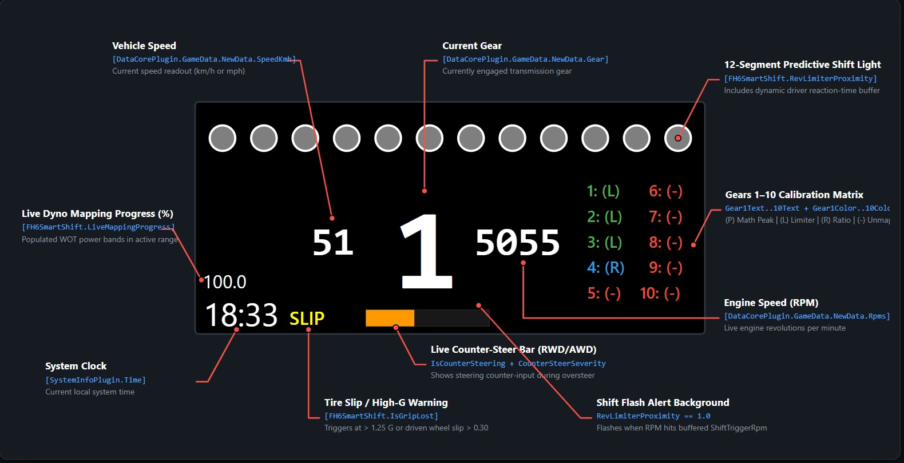

# 🏎️ FH6SmartShift (v1.0.0) — Virtual Dyno & Shift Telemetry System for Forza Horizon 6

[](https://www.simhubdash.com/)
[](https://dotnet.microsoft.com/)
[](https://docs.microsoft.com/en-us/dotnet/csharp/)
[](https://www.gnu.org/licenses/gpl-3.0)
[](https://buymeacoffee.com/mtowarek01d)

**Author:** mtowarek01  
**Version:** v1.0.0 (Ultimate Monolith, Zero Stutter & Top Gear Fix)

---

## 📖 About the Project

**FH6SmartShift** is an advanced C# telemetry plugin for **SimHub** and a dedicated racing dashboard designed specifically for the **Forza Horizon 6** physics engine.

Unlike simple scripts that only average rev-limiter bounce RPM, **FH6SmartShift** builds a real-time (60 Hz) engine profile based on a **401-band Virtual Dyno**. By capturing raw UDP data from the game — including engine power (`Power`), torque (`Torque`), boost pressure (`Boost`), wheel rotation speeds (`WheelRotationSpeed`), longitudinal and lateral tire slip (`TireSlipRatio`, `TireSlipAngle`), and suspension travel — the plugin calculates transmission gear ratios and finds the exact power curve intersection point between consecutive gears (Gears 1–10).

Additionally, the system provides chassis dynamics telemetry for RWD and AWD vehicles: a power oversteer warning (`PowerOversteerWarning`), a counter-steering indicator (`IsCounterSteering`), and a safe downshift calculator that accounts for braking force and front-axle dive (`DbgChassisDive`).



---

## ⚙️ Architecture & Actual Operating Logic

* **401-Band Virtual Dyno (`PowerMap`, `TorqueMap`, `BoostMap`):** Sampling takes place exclusively near wide-open throttle (`Accel >= 242` on a `0–255` scale, i.e., **~95% throttle**) and at power levels above `5000 W`. The range up to `20,000 RPM` is divided into 401 bands in `50 RPM` increments and smoothed using an adaptive EMA filter (`alpha = max(1/samples, 0.05)`).
* **Power Curve Intersection Algorithm (`EvaluateAllMathIntersections`):** Every `0.20 s` (when data has changed), the algorithm compares the smoothed telemetry engine power in the current gear (`pNow` at `r` RPM) against the power after upshifting to the next gear (`pNext` at landing RPM `r * dropRatio`). If the engine is turbocharged (`Boost > 0.1`) and the expected boost pressure after the gear change drops below `70%` of the current boost, `pNext` is adjusted by a `0.85` multiplier. A shift point is confirmed as mathematically optimal `(P)` when, for `r >= RpmAtMaxPower`, the condition **`pNext >= pNow * 1.015`** (1.5% power advantage) is met across **6 consecutive 25 RPM steps** (or 2 steps near the end of the mapped ceiling), and the sample density in the target band is at least **85%**.
* **Autonomous Gear Ratio Learning (`RpmPerRadS`):** The `CurrentEngineRpm / avgWheelSpeed` ratio is recorded when `Accel >= 242`, with no braking (`Brake < 5.0`), slip across all wheels `< 0.10`, wheel speed `> 20 rad/s`, and engine speed `> 1000 RPM`. Samples are stored in a 25-element circular buffer, and **median calculation and ratio confirmation occur once a minimum of 15 samples are collected**. The system verifies gear ratio monotonicity and automatically resets the transmission data upon detecting inconsistencies (e.g., after a tuning change).
* **Hidden Limiter Detection (`GhostLimiterRpm`):** Detects situations where a power cut (`powerRatio < 0.85` or an RPM drop `_currentRpmAccel < -150 RPM/s` for at least `0.05 s`) occurs above `RpmAtMaxPower + 100`, but before the nominal `EngineMaxRpm`. After hitting the same band twice (`±150 RPM`), the plugin locks `GhostLimiterRpm` and purges contaminated power bands (`CleanUpContaminatedBands`). If the engine subsequently exceeds `GhostLimiterRpm + 150 RPM` with rising RPM for `0.10 s`, the ghost limiter lock is automatically removed.
* **Multi-Layer Physics Filters (`filtersOk`):** Writing to the power map is paused whenever any of the following conditions occur:
  1. Any wheel leaves the ground (`NormalizedSuspensionTravel <= 0.02`).
  2. Driving into a puddle (`WheelInPuddleDepth > 0.01` on any wheel).
  3. Vehicle damage (`Damage1 > 0.05` or `Damage2 > 0.05`).
  4. Sudden **rear** suspension rebound (`|ΔSuspensionTravelMetersRear| > 0.08 m` between frames for the RL or RR wheel — the front axle is not covered by this filter).
  5. Surface vibration (`SurfaceRumble > 0` on any wheel).
  6. Clutch or handbrake engagement (`Clutch >= 2.0` or `HandBrake >= 2.0`), or post-shift stabilization time (`0.30 s` upshift, `0.50 s` downshift, `0.15 s` clutch).
  7. Exceeding the `tractionOk` threshold: driven wheel longitudinal slip `>= 0.65` (gears 1–3) or `>= 0.40` (gears 4+), or slip angle `>= 0.25`.
* **Downshift & Climb Assistant (`Downshift` & `_climbDownshiftActive`):** The safe downshift threshold (`DownshiftTriggerRpm`) is raised proportionally to braking force (up to `+600 RPM`) and dynamic front-axle dive (`DbgChassisDive`, up to `+250 RPM`), but capped by a hard ceiling of `(actualLimiter - 150) * dropFromPrev`. An independent `_climbDownshiftActive` algorithm suggests a downshift while driving under load when: `Accel >= 230` (~90% throttle), the speed trend is `<= +1.0 km/h/s` (decelerating or maintaining constant speed), power in the lower gear is higher by at least **5%** (`pLand > pNow * 1.05`), post-downshift RPM is at least `300 RPM` below the lower gear's shift point, and driven wheel slip does not exceed `0.15`.
* **Memory & Data Persistence Optimization:** Dyno computation arrays are statically pre-allocated. Reading telemetry from SimHub executes ~53 `GetPropertyValue` calls per frame (with primitive type boxing overhead). Disk saving takes place asynchronously every `15 s` minimum (when data has changed): the plugin performs a deep copy of all car dictionaries (`CloneCarStore`) inside a `lock` statement and offloads the JSON serialization itself to a background `Task.Run` thread, eliminating race stutters.

---

## 📂 Repository Contents & File Paths

```text
├── FH6SmartShift.cs                  # Full C# source code of the plugin
├── FH6SmartShift.csproj              # .NET Framework 4.8 (C# 7.3) project file with DeployToSimHub target
├── FH6SmartShift.dll                 # Compiled library ready to be pasted into SimHub
├── FH6SmartShift_Dashboard_EN.png    # Annotated dashboard infographic
├── Dashboard/                        # Folder containing the dedicated SimHub dashboard
├── README.md                         # Online repository documentation
└── README.pdf                        # Printable offline user manual & property reference
```

### Database and Backup Locations
* **Main database file:** `C:\Program Files (x86)\SimHub\PluginsData\Common\FH6SmartShift_fh6SmartShiftingData.json`
* **Automatic backups:** Upon SimHub startup, the plugin creates a daily backup in the `PluginsData\Common\` directory named `FH6SmartShift_fh6SmartShiftingData.json.bak_yyyyMMdd` and retains the 3 most recent copies, automatically deleting older ones.

---

## 🛠️ Installation Guide

### Option A: Quick Installation (Pre-compiled `.dll` + Dashboard)
1. Completely close SimHub (the running application locks `.dll` files).
2. Copy `FH6SmartShift.dll` directly into the main SimHub directory (by default `C:\Program Files (x86)\SimHub\`).
3. Launch SimHub and enable the **FH6SmartShift** plugin in the prompt dialog.
4. Import the contents of the `Dashboard/` folder into SimHub Dash Studio (by double-clicking the `.simhubdash` file or copying the folder to `C:\Program Files (x86)\SimHub\DashTemplates\`).
5. In Forza Horizon 6 settings (**HUD and Gameplay -> Data Out**), enable UDP telemetry and configure the IP address and port to match SimHub.

### Option B: Building from Source Code
1. Install the .NET SDK with support for .NET Framework 4.8 (`net48`).
2. If SimHub is installed in a location other than `C:\Program Files (x86)\SimHub\`, set the `SIMHUB_INSTALL_PATH` environment variable.
3. Close SimHub and run the following command in the repository directory:
   ```bash
   dotnet build FH6SmartShift.csproj -c Release
   ```
4. The `DeployToSimHub` target embedded in `.csproj` will automatically copy the resulting `.dll` file into the SimHub directory.

---

## 📊 Dashboard User Guide — How to Read the Indicators

Below is a detailed breakdown of how each element on the included dashboard operates, fully aligned with the underlying C# code logic:

1. **Top LED Bar (12-Segment Shift Light):** Bound to `[FH6SmartShift.RevLimiterProximity]`. Progression from `0.0` to `1.0` is calculated starting from 75% of the range between idle RPM (`EngineIdleRpm`) and the unbuffered shift point (`visualTrigger`). The moment RPM reaches `ShiftTriggerRpm` (reduced by a dynamic driver reaction-time buffer — up to `1500 RPM` earlier in gears 1–2 and up to `600 RPM` in gears 3+) at throttle `Accel >= 230`, the plugin immediately forces a value of `1.0`. A full LED bar means: **"shift now (accounting for your reaction time)"**.
2. **Dashboard Warning Background (Background Shift Flash):** Bound to `RevLimiterProximity == 1.0`. Changes background color when the lead-time shift signal activates.
3. **Central Instrument Cluster (Gear `1`, Speed `51`, RPM `5055`):** Displays currently engaged transmission gear (center), current speed (left), and live engine RPM (right).
4. **Mapping Progress Indicator (`100.0`):** Bound to `[FH6SmartShift.LiveMappingProgress]`. Shows the percentage of populated power buckets from `max(1000, 0.50 * RpmAtMaxPower)` up to `actualLimiter - 250 RPM`. *(Note: `[FH6SmartShift.MapCoverageBar]` scans all the way to `actualLimiter` without subtracting 250 RPM).*
5. **`SLIP` Indicator (Slip / G-Force Warning):** Bound to `[FH6SmartShift.IsGripLost]`. Illuminates yellow when combined lateral/longitudinal G-force exceeds `1.25 G` or driven wheel longitudinal slip exceeds `0.30`. *(Note: Dyno writing is gated separately by `tractionOk`, which permits slip up to `0.65` in gears 1–3 and `0.40` in gears 4+).*
6. **Orange Counter-Steer Bar (Bottom of Screen):** Bound to `[FH6SmartShift.IsCounterSteering]` and `[FH6SmartShift.CounterSteerSeverity]`. Active exclusively in RWD and AWD cars above `20 km/h` when `OversteerSeverity > 0.30`, steering input `|Steer| / 127.0 > 0.15`, yaw velocity `|AngularVelocityY| > 0.30`, and steering direction is opposite to yaw rotation. Never activates in FWD cars.
7. **System Clock (`18:33`):** Displays current local system time in the bottom-left corner.
8. **Gears 1–10 Calibration Matrix (Right Side of Screen):** Bound to `Gear1Text..Gear10Text` and `Gear1Color..Gear10Color`. When paused or in menus (`IsRaceOn == 0`), `ResetOutputs()` turns all gears red `(-)` (`#E74C3C`) until returning to the road.

| Designation | Color | Hex Code | Actual Condition in C# Code |
| :--- | :--- | :--- | :--- |
| **`N: (P)`** | 🟢 Green | `#4CAF50` | **Peak Optimal (`IsConfirmed && IsMathOptimal`):** Confirmed power curve intersection with gear `N+1` (`pNext >= 1.015 * pNow`) and target band density `>= 85%`. |
| **`N: (L)`** | 🟢 Green | `#4CAF50` | **Limiter Confirmed (`IsConfirmed && TriggerIsGhost`):** Appears when (1) `GhostLimiterRpm > 0` is detected near ceiling (`validCeiling >= actualLimiter - 300`), or (2) highest known gear (`!hasHigherGear`) was revved at WOT (`Accel >= 242`) to `actualLimiter - 100 RPM`. |
| **`N: (L?)`** | 🟠 Orange | `#F39C12` | **Edge / Unconfirmed Limit (`TriggerIsEdge`):** Power curves did not intersect before cutoff on a gear with `N+1` available, and no ghost limiter was detected. Provisional trigger: `actualLimiter - 250 RPM`. |
| **`N: (P?)`** | 🟡 Yellow | `#F1C40F` | **Unconfirmed Trigger (`PowerPeakCaught && ShiftTriggerRpm > 0`):** Gear has a saved threshold (`ShiftTriggerRpm > 0`), but lost confirmation (`IsConfirmed == false`) and is not flagged as `TriggerIsEdge`. |
| **`N: (R)`** | 🔵 Blue | `#3498DB` | **Ratio Locked (`RpmPerRadS > 0`):** Gear ratio learned (at WOT, `>= 15` samples), waiting for gear `N+1` ratio or top-gear WOT run to limiter. |
| **`N: (-)`** | 🔴 Red | `#E74C3C` | **Unmapped / Paused:** Gear has no learned ratio yet, memory was reset, or game is paused/in menu (`IsRaceOn == 0`). |

---

## 🔌 Full Specification of SimHub Properties & Actions

### Telemetry Properties (`[FH6SmartShift.<PropertyName>]`)

| Property | Type | Exact Behavior in Code |
| :--- | :--- | :--- |
| `MaxUsableRpm` | `double` | Returns the exact same value as `ShiftTriggerRpm`. Retained for backward compatibility. |
| `ShiftTriggerRpm` | `double` | Shift Light activation point reduced by the smoothed driver reaction-time buffer (`realCurrentShift - liveBuffer`, capped at `actualLimiter - 50`). |
| `OptimalShiftRpm` | `double` | Returns mathematical shift point for `(P)` gears. Returns `actualLimiter - 250` for `(L?)`, `ShiftTriggerRpm - 50` for `(L)`, and `actualLimiter - 50` when unmapped. |
| `DownshiftTriggerRpm` | `double` | Safe downshift RPM threshold increased by braking and front-end dive corrections (`DbgChassisDive`), capped at `(actualLimiter - 150) * dropRatio`. |
| `RevLimiterProximity` | `double` | `0.0–1.0`. Rises linearly toward `visualTrigger`, jumping to `1.0` upon reaching buffered `ShiftTriggerRpm` at `Accel >= 230`. |
| `LiveMappingProgress` | `double` | Percentage (`0.0–100.0`) of populated power bands from `max(1000, 0.5 * RpmAtMaxPower)` to `actualLimiter - 250`. |
| `MapCoverageBar` | `string` | 20-character progress bar `[████████░░░░░░░░░░░░]` from `max(1000, 0.5 * RpmAtMaxPower)` to `actualLimiter` (refreshed every `0.5 s`). |
| `EngineMapStatus` | `string` | `"OK"` when `LiveMappingProgress >= 95.0`, otherwise `"LEARN"`. |
| `RpmAtMaxPower` | `double` | RPM at which the highest smoothed engine power was recorded. |
| `RpmAtMaxTorque` | `double` | RPM at which the highest smoothed engine torque was recorded. |
| `CurrentCarKey` | `string` | Vehicle and tuning identifier: `{CarOrdinal}_PI{PI}_DT{Drivetrain}_R{RoundedMaxRpm}`. |
| `IsLearningComplete` | `bool` | `true` when current gear has `IsConfirmed == true` (`(P)`, `(L)`) or `TriggerIsEdge == true` (`(L?)`). |
| `IsTopGear` | `bool` | `true` when `currentGear >= 5`, ratio is learned and confirmed, and it is the highest known gear (or next gear has `dropRatio >= 0.88`). |
| `IsDownshiftSafe` | `bool` | `true` when `currentGear > 1` and `currentRpm <= DownshiftTriggerRpm`. |
| `IsDownshiftSuggested` | `bool` | `true` when RPM drops to `<= DownshiftTriggerRpm - 250` (above `10 km/h`) or `_climbDownshiftActive` is triggered. |
| `IsTractionGood` | `bool` | `true` when driven wheel slip is `< 0.65` (gears 1–3) or `< 0.40` (gears 4+) and slip angle is `< 0.25`. |
| `IsGripLost` | `bool` | `true` (`SLIP` indicator) when combined G-force `> 1.25 G` or driven wheel slip `> 0.30`. |
| `PowerOversteerWarning` | `bool` | `true` for RWD/AWD in gear `>= 1` when `Accel >= 230` and rear combined slip `> 0.6`. |
| `OversteerSeverity` | `double` | `0.0–1.0` rear-axle slip scale for RWD/AWD above `20 km/h` (70% rear slip angle `> 0.12`, 30% combined slip `> 0.65`). |
| `IsCounterSteering` | `bool` | `true` when `CounterSteerSeverity > 0.10` (never activates for FWD cars). |
| `CounterSteerSeverity` | `double` | Smoothed (`tau = 0.08 s`) `0.0–1.0` steering input above 15% threshold during counter-steering. |
| `BodySlipAngle` | `double` | Chassis slip angle in degrees calculated from `VelocityX` vs `|VelocityZ|` (above `5 km/h`). |
| `AeroBottomingWarning` | `bool` | `true` when any damper reaches `NormalizedSuspensionTravel >= 0.98` above `200 km/h`. |
| `Gear1Text`..`Gear10Text` | `string` | Status text labels for gears 1–10. |
| `Gear1Color`..`Gear10Color` | `string` | Status Hex color codes for gears 1–10. |
| `Dbg_ChassisDive` | `double` | Dynamic front-end dive relative to `_staticChassisDiveBase`. |
| `Dbg_GhostLimiter` | `double` | Detected `GhostLimiterRpm` ceiling (`0` if not detected). |
| `Dbg_GhostCandidate` | `double` | Current hidden limiter candidate prior to second-hit confirmation. |
| `Dbg_GhostHits` | `int` | Hit counter for the hidden limiter candidate. |
| `Dbg_SteerRaw` / `Dbg_YawRaw` | `double` | Raw steering (`Steer`) and yaw velocity (`AngularVelocityY`) values. |

### SimHub Actions
* **`FH6SmartShift.ResetPowerMemory`** — Clears the engine map, gear ratios, and shift points for the current car.
* **`FH6SmartShift.ResetGearRatios`** — Clears only the gear ratios and shift points for the current car while preserving the engine power map (useful after adjusting gear ratios in the tuning menu).
* **`FH6SmartShift.ResetLimitGears`** — Clears only non-optimal shift points (`!IsMathOptimal`, i.e., `(L)` and `(L?)`) for the current vehicle.
* **`FH6SmartShift.ResetAllCarsMemory`** — Complete database reset for all saved cars.

---

## ⚠️ Known Design Limitations

1. **Electric Vehicles (EVs) and 1–4 Speed Transmissions:**
   * The `IsTopGear` flag requires a hard condition of `currentGear >= 5`, meaning it will never evaluate to `true` in cars with 1 to 4 gears.
   * Single-speed EVs do not have a subsequent gear (`N+1`), and their flat upper-RPM power curve can trigger `GhostLimiterRpm`.
2. **No Counter-Steer Indicator Activation in FWD Cars:**
   * Due to the `drivetrainType == RWD || AWD` condition, `OversteerSeverity`, `IsCounterSteering`, and `CounterSteerSeverity` always remain `0` / `false` in FWD vehicles.

---

## 📜 License & Support

Distributed under the **GNU General Public License v3.0 (GPLv3)**.

If **FH6SmartShift** helped you shave tenths off your lap times and dial in your gear ratios in Forza Horizon 6, you can support the project's development:

👉 **[Support the creator on Buy Me a Coffee](https://buymeacoffee.com/mtowarek01d)** (`https://buymeacoffee.com/mtowarek01d`)
